# Praktikum 7 - Pemrograman Server-Side dengan PHP

| | |
|---|---|
| **Nama** | Nurfaiz Pradibto Nugroho |
| **NIM** | 312510172 |
| **Kelas** | I253C |
| **Program Studi** | Teknik Informatika |
| **Mata Kuliah** | Pemrograman Web |
| **Dosen Pengampu** | Agung Nugroho, S.Kom., M.Kom. |

## Tujuan Praktikum
- Memahami perbedaan pemrosesan client-side dan server-side.
- Menjalankan file PHP melalui server lokal.
- Menggunakan variabel, tipe data, operator, percabangan, perulangan, dan function.
- Memproses data form HTML dengan metode GET dan POST.
- Melakukan validasi dan sanitasi input dasar.
- Membangun aplikasi sederhana yang menerima, memproses, dan menampilkan data pengguna.

## Perangkat
Laptop/PC, web browser, Visual Studio Code, PHP, dan XAMPP v3.3.0 sebagai server lokal (Apache).

## Cara Menjalankan Server Lokal
1. Buka **XAMPP Control Panel**, lalu klik **Start** pada modul **Apache** sampai statusnya hijau (port 80, 443).
2. Letakkan folder proyek `lab7_php` di `C:\xampp\htdocs\`.
3. Buka browser dan akses `http://localhost/lab7_php/`.
4. Jangan membuka file `.php` dengan klik ganda, karena PHP hanya dieksekusi lewat web server.

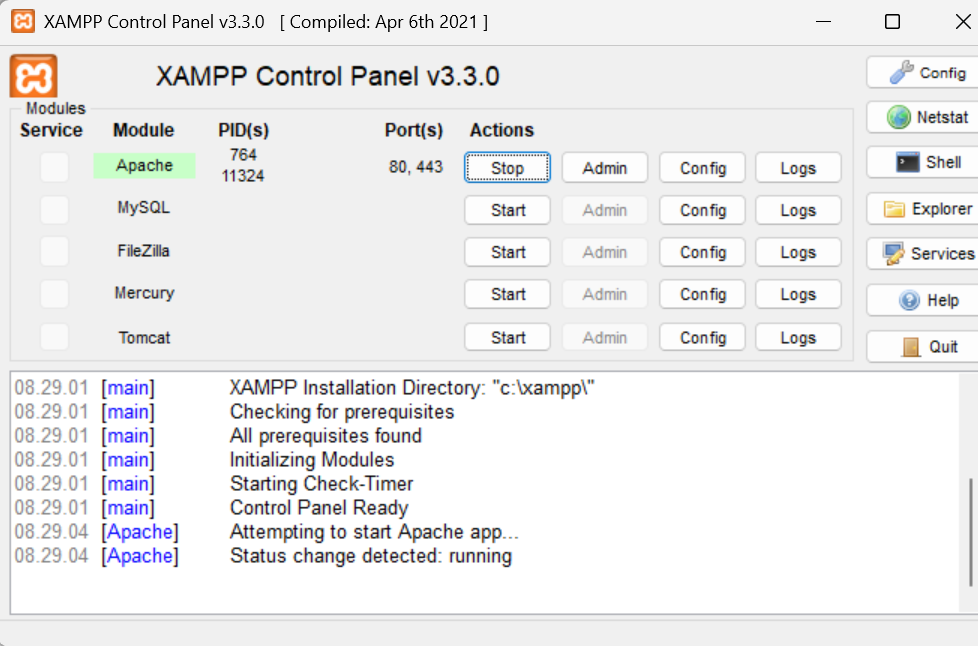

## Struktur File
```
lab7_php/
├── index.php            # Latihan 1 + menu navigasi
├── latihan2.php         # Variabel, operator, percabangan
├── latihan3.php         # Perulangan dan array
├── latihan4.php         # Function
├── latihan5_get.php     # Form GET
├── latihan6_post.php    # Form POST
├── latihan7.php         # Pengolahan data (subtotal transaksi)
├── mini_project.php     # Formulir Data Mahasiswa
├── eksperimen.php       # Eksperimen mandiri
├── screenshots/         # Tangkapan layar hasil praktikum
└── README.md
```

## Ringkasan Hasil

### Latihan 1 - Menjalankan PHP (`index.php`)
Halaman menampilkan judul "Belajar PHP", teks "PHP berhasil dijalankan.", waktu server dari `date()`, dan menu menuju latihan lain. Browser hanya menerima hasil HTML, bukan kode PHP mentah.

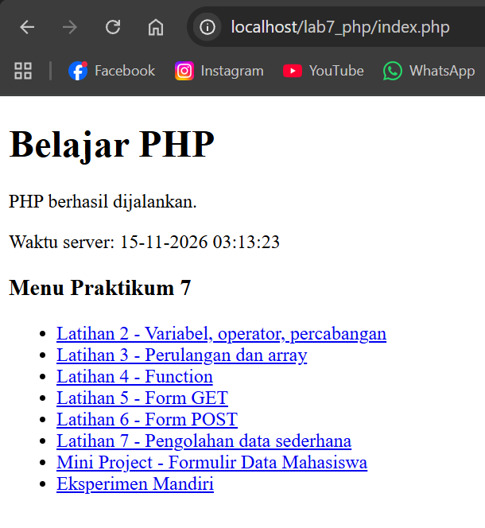

### Latihan 2 - Variabel, Operator, Percabangan (`latihan2.php`)
Nilai akhir dihitung dengan bobot tugas 30%, UTS 30%, UAS 40%. Untuk tugas 85, UTS 78, UAS 90 hasilnya **84.90** dengan predikat **B**.


| Tugas | UTS | UAS | Nilai akhir | Predikat |
|---|---|---|---|---|
| 85 | 78 | 90 | 84,90 | B |
| 100 | 100 | 100 | 100,00 | A |
| 80 | 80 | 80 | 80,00 | B |
| 60 | 60 | 60 | 60,00 | C |
| 50 | 50 | 50 | 50,00 | D |

### Latihan 3 - Perulangan dan Array (`latihan3.php`)
Array berisi 7 nama mahasiswa (4 awal + Eka, Fajar, Gita) ditampilkan dengan `foreach` dalam daftar bernomor, lalu jumlahnya (7) ditampilkan dengan `count()`.

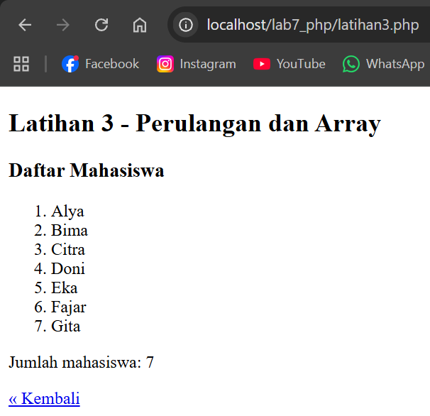

### Latihan 4 - Function (`latihan4.php`)
- `hitungDiskon(150000, 10)` menghasilkan **Rp135.000**.
- `hitungLuasPersegiPanjang(8, 4)` menghasilkan **32**.
- `tentukanKelulusan()`: nilai 72 = **LULUS**, nilai 45 = **TIDAK LULUS**.

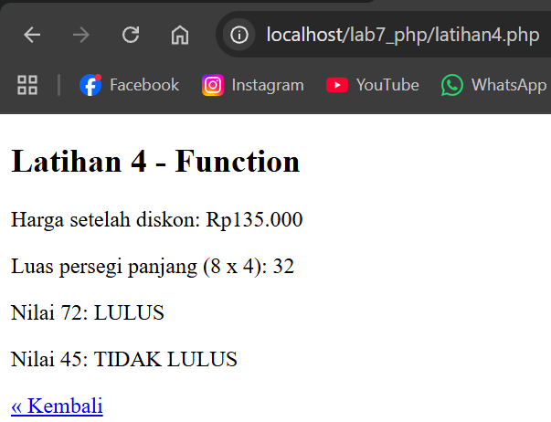

### Latihan 5 - Form GET (`latihan5_get.php`)
Setelah kata kunci "php" dikirim, URL berubah menjadi `latihan5_get.php?kata=php` sehingga data terlihat di address bar. Karena itu GET tidak boleh dipakai untuk data sensitif seperti kata sandi.

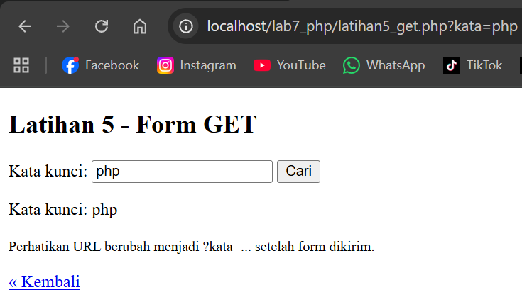

### Latihan 6 - Form POST (`latihan6_post.php`)
Data lengkap (nama dan program studi) ditampilkan pada bagian "Data diterima" dan tidak muncul di URL. Saat kolom dikosongkan, browser menampilkan pesan "Harap isi bidang ini." dari atribut `required`; validasi server-side di PHP tetap menjadi pemeriksaan utama.

| Data valid | Kolom kosong |
|---|---|
| 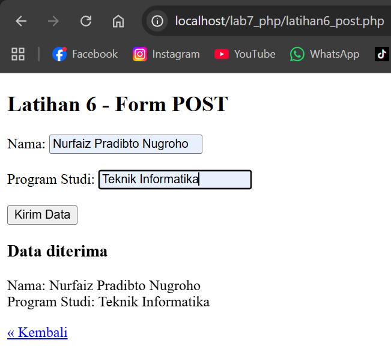 | 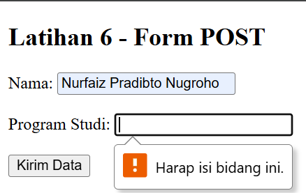 |

### Latihan 7 - Pengolahan Data Sederhana (`latihan7.php`)
Form menghitung subtotal (harga x jumlah). Contoh: barang Buku, harga 12500, jumlah 3 menghasilkan **Rp37.500**. Jumlah di bawah 1 (misalnya -2) ditolak; pada tangkapan layar, browser menampilkan "Nilai harus lebih besar daripada atau sama dengan 1." dari atribut `min`, dan PHP tetap memvalidasi ulang di server.

| Input valid | Input tidak valid |
|---|---|
| 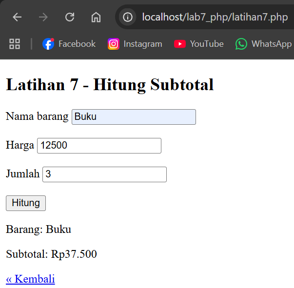 | 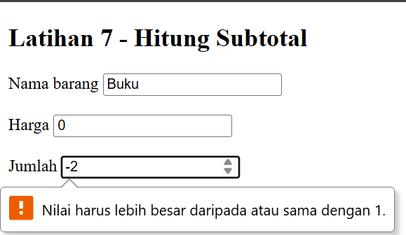 |

### Mini Project - Formulir Data Mahasiswa (`mini_project.php`)
Aplikasi menerima nama, NIM, program studi, semester, dan email lewat POST. Validasi server-side meliputi:
- kolom nama, NIM, dan program studi wajib diisi,
- NIM hanya angka dengan panjang 8-12 digit,
- semester bilangan bulat 1-14,
- format email valid (`filter_var`).

Bagian pemrosesan dipisah dari tampilan HTML, seluruh pesan error ditampilkan sekaligus, dan semua output memakai `htmlspecialchars()`.

**Kasus uji**

| No | Input | Hasil | Jenis |
|---|---|---|---|
| 1 | Nurfaiz Pradibto Nugroho, NIM 312510172, Teknik Informatika, semester 3, nurfaiznugroho2@gmail.com | Ringkasan data ditampilkan | Valid |
| 2 | Data sama, semester 14 (batas atas) | Ringkasan data ditampilkan | Valid |
| 3 | Semua kolom kosong | Error: nama, NIM, prodi wajib diisi; email tidak valid; semester harus 1-14 | Tidak valid |
| 4 | NIM `12AB34`, semester 15, email `nurfaiznugroho@`, nama dan prodi kosong | Error: nama wajib diisi; NIM harus angka 8-12 digit; prodi wajib diisi; email tidak valid; semester harus 1-14 | Tidak valid |

**Input valid (kasus 1 dan 2)**

| Semester 3 | Semester 14 |
|---|---|
| 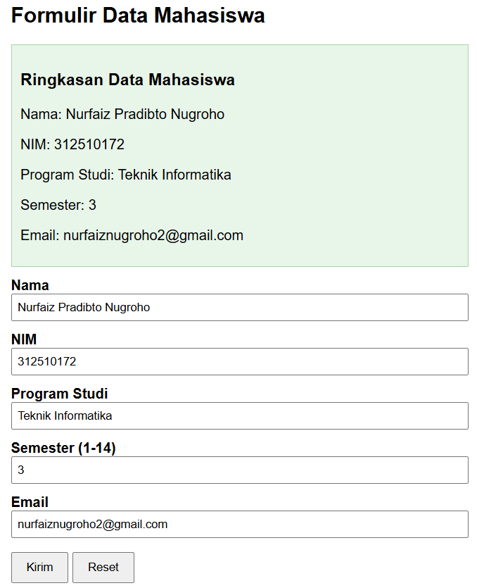 | 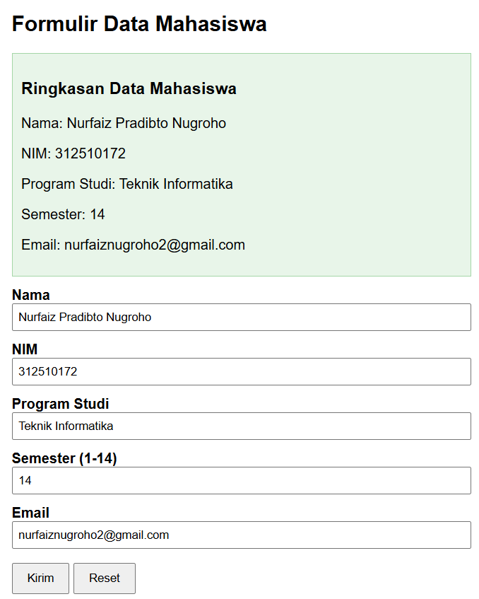 |

**Input tidak valid (kasus 3 dan 4)**

| Semua kolom kosong | NIM, semester, dan email salah |
|---|---|
| 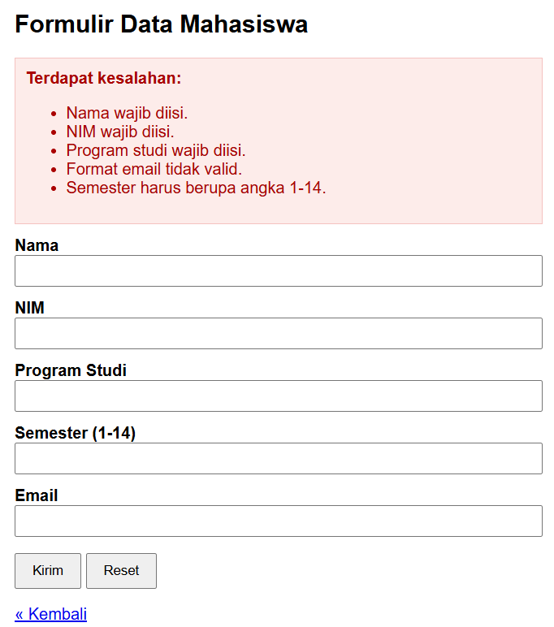 | 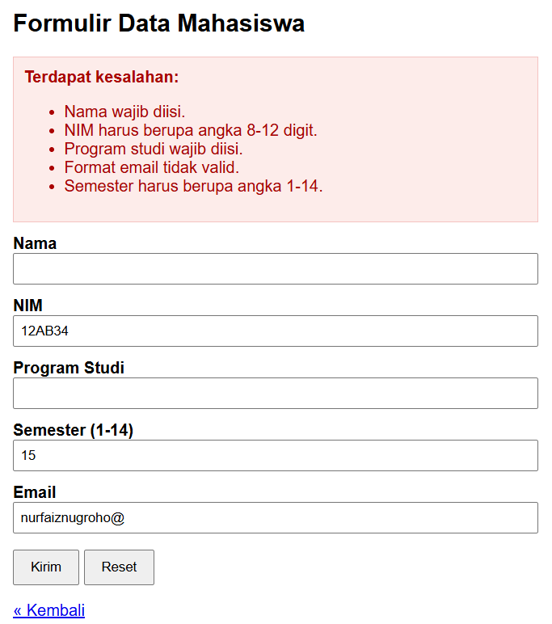 |

### Eksperimen Mandiri (`eksperimen.php`)
1. Rata-rata tiga nilai (80, 75, 90) = **81.67**.
2. Pencarian nama dari array dengan GET (`?cari=...`) memakai `stripos()`. Pada tangkapan layar, kata kunci "Nurfaiz Pradibto Nugroho" tidak ada di array sehingga tampil "Nama tidak ditemukan."
3. Function `formatRupiah()`: **Rp1.500.000** dan **Rp25.000**.
4. Validasi NIM (angka saja, 8-12 digit) diterapkan di `mini_project.php`.
5. Tombol Reset hanya mengembalikan isian form di browser tanpa request ke server, sedangkan tombol Kirim mengirim data ke server untuk diproses ulang oleh PHP.

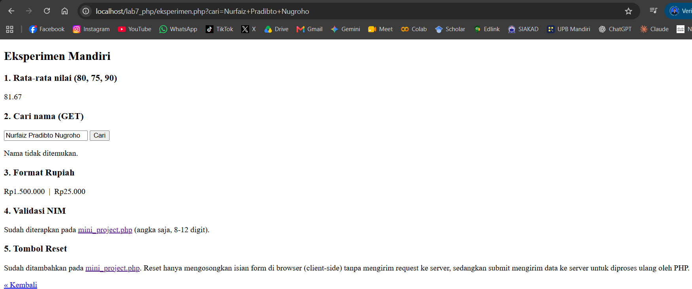

## Jawaban Singkat Pertanyaan Evaluasi
1. **Client-side vs server-side:** client-side diproses di browser (HTML, CSS, JavaScript), server-side diproses di server (PHP) lalu hasilnya dikirim ke browser sebagai HTML.
2. **Kenapa lewat web server:** PHP membutuhkan interpreter di server; jika dibuka dengan klik ganda, kodenya hanya tampil sebagai teks.
3. **Tanda `$`:** penanda variabel di PHP (bersifat case-sensitive).
4. **GET vs POST:** GET mengirim data lewat URL (terlihat, cocok untuk pencarian); POST mengirim data lewat body request (tidak tampil di URL, lazim untuk form) dan bukan enkripsi, sehingga tetap perlu HTTPS.
5. **Validasi server-side:** validasi di browser mudah dilewati, sedangkan validasi server menjamin data benar dan aman.
6. **`htmlspecialchars()`:** mengubah karakter khusus HTML menjadi entitas agar input tampil sebagai teks dan tidak dieksekusi (mengurangi risiko XSS).
7. **Function:** kode dapat dipakai ulang, rapi, serta mudah diuji dan dipelihara.

## Kesimpulan
PHP berjalan di sisi server dan menghasilkan HTML untuk browser. Konsep dasar PHP, pemrosesan form GET dan POST, serta validasi dan sanitasi input berhasil diterapkan, sehingga aplikasi menerima data yang benar dan menampilkan output dengan aman.
